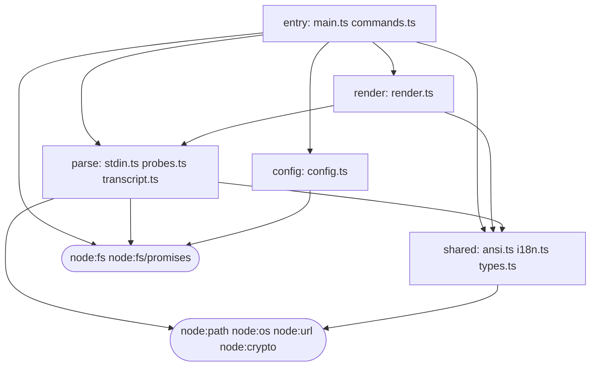

# Architecture

`agy-hud` adapts the **Capability vs. Logic Cage** architecture pioneered by [`jarrodwatts/claude-hud`](https://github.com/jarrodwatts/claude-hud) to **Google Antigravity CLI (`agy`)**.

## 1. THE LINE: Capability Layer vs. Caged Logic Layer

Every render triggered by `agy` CLI's `statusLine` engine crosses an explicit security boundary (`THE LINE`):

```text
Antigravity CLI (agy)
  │  pipes statusLine JSON payload on stdin (throttled 300ms, max 5s)
  ▼
┌─ CAPABILITY LAYER (scripts/) ───────────────────────────────────────────────────┐
│  hud.mjs:       bounded stdin reader, AGY_HUD_DISABLE gate, heartbeat,          │
│                 spawns caged child process, enforces `terminalFilter` allowlist │
│  collector.mjs: resolves exact paths, caches stripped TS (`stripped/`),         │
│                 sweeps symlinks in `data/`, executes fixed git & vm_stat probes │
│  fence.mjs:     `--import` hook blocking child_process/net/http/fetch/sockets   │
│  install.mjs:   atomic backup & update of ~/.gemini/antigravity-cli/settings    │
└───────────────────────────┬─────────────────────────────▲───────────────────────┘
                            │ NDJSON over raw fd 0        │ NDJSON over raw fd 1
═══════════ THE LINE ═══════╪═════════════════════════════╪════════════════════════
┌─ CAGED LOGIC LAYER (src/) ▼─────────────────────────────┴───────────────────────┐
│  Runs under: `node --permission --disallow-code-generation-from-strings`        │
│              `--allow-fs-read=<exact-granted-paths> --allow-fs-write=<data/>`   │
│              `--import=./scripts/fence.mjs`                                     │
│  Parses stdin, tail-reads `transcript.jsonl` + `task.md`, requests named probes │
│  (`vcs`, `memory`), formats ANSI lines, and handles `/hud` subcommands.         │
└─────────────────────────────────────────────────────────────────────────────────┘
```

### Defense-in-Depth Guarantees
1. **Filesystem confinement (`node --permission`)**: Logic can read only the plugin's own files, HUD config, `settings.json` (for `doctor`), and the active session's `transcript.jsonl` + `task.md`. It can write **only** inside `<hudHome>/data` (whose symlinks are swept prior to launch).
2. **Import & Global Fence (`scripts/fence.mjs`)**: `module.registerHooks` blocks `node:child_process`, `node:net`, `node:http`, `node:https`, `node:tls`, `node:worker_threads`, `node:vm`, and external URLs. `fetch`, `WebSocket`, `process.binding`, `process.dlopen`, `process.kill`, and `net.Socket` stdio streams are sealed before logic loads.
3. **Terminal Escape Firewall (`terminalFilter`)**: Logic never decides what raw escape sequences reach the user's terminal. `hud.mjs` strips OSC 52 clipboard reads, window-title hijacks, cursor jumps, control bytes, and Unicode bidi Trojan characters, keeping only SGR color sequences (`\x1b[...m`) and `file:` OSC 8 hyperlinks.

## 2. Logic Module Graph (Verified as a Test)

`tests/arch.test.mjs` parses the Mermaid graph below on every test run, strips TypeScript types from `src/*.ts`, inspects actual runtime imports, and fails if any file is unassigned, if any import crosses layers without a declared arrow, or if the rounded nodes diverge from `ALLOWED_BUILTINS` in `scripts/fence.mjs`.


