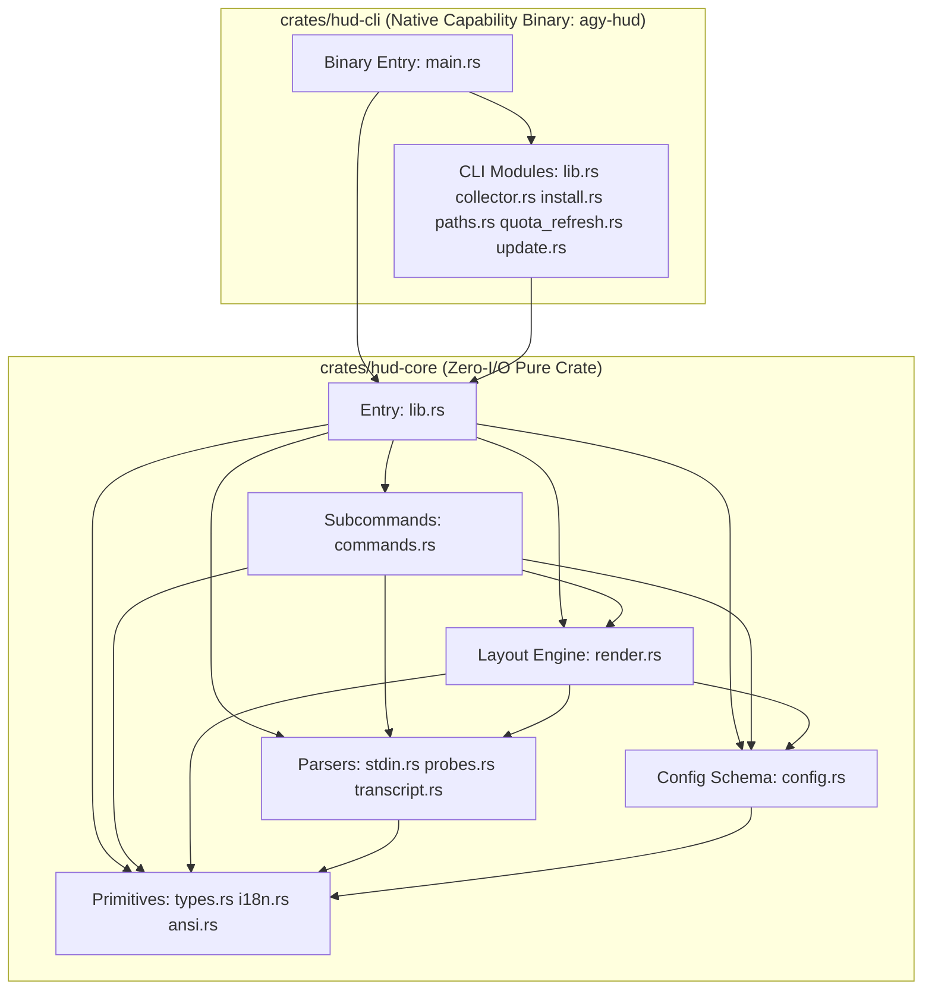

# `agy-hud` v1.7.1 — 100% Pure Rust Single-Engine Architecture

`agy-hud` is a **100% Pure Rust** native statusLine HUD for the Google Antigravity CLI (`agy`). There is **zero Node.js / TypeScript runtime or wrapper code** in the repository.

Every statusLine refresh runs a single precompiled native binary (`agy-hud`), achieving ~1–4 ms warm latency while preserving strict **Capability Shell vs. Pure Logic Core** separation at compile time.

---

## 1. Security Boundary: Compile-Time Crate Isolation (`THE LINE`)

Instead of spawning a second runtime VM per render, `agy-hud` enforces capability isolation directly through Rust's module, crate, and type systems (continuously audited by `crates/hud-core/tests/arch_guard.rs`):

1. **`crates/hud-core` (Pure Logic Crate — Zero I/O, `#![forbid(unsafe_code)]`)**
   - Depends **only** on `serde` and `serde_json` (11 total transitive crates, zero network/OS crates).
   - Strictly forbidden from referencing `std::fs`, `std::process`, `std::net`, `std::env`, or `std::os`.
   - Owns all untrusted JSON/JSONL/Markdown parsing (`stdin.rs`, `transcript.rs`, `probes.rs`), `CONFIG_SCHEMA` validation (`config.rs`, 53 keys), extended grapheme cluster width/truncation & capability-scoped `terminal_filter_with_repo` output escape firewall (`ansi.rs`), composable multi-layout CJK-aware rendering (`render.rs`), `256k` auto-compaction watermark scaling & `↻N` compaction tracking, hybrid `~tok/s` speed-tier & session `(min~max)` throughput tracking, quota pace & cross-session cost ledger reconciliation, width-preserving privacy scrubbing (`commands.rs`), and the declarative corpus snapshot suite (`tests/corpus/*.json` + `tests/corpus_cases.rs`).
2. **`crates/hud-cli` (Thin Capability Binary — `#![forbid(unsafe_code)]`)**
   - Owns non-blocking early-exit `stdin` JSON reading (`1000 ms` open-pipe guard, `256 KB` cap, `AGY_HUD_NESTED=1` fast inert exit), incremental `O(Δ)` `transcript.jsonl` byte-cursor reading (`<hudHome>/data/transcript-cursors/<fnv64>.json`, keeping only the active tail step uncommitted, including session min/max speed bounds), atomic throughput snapshot persistence (`<hudHome>/data/speed-cache.json`), exclusive-lockfile cross-session cost ledger persistence (`<hudHome>/data/cost-ledger.json` + `cost-ledger.lock`), symlink-swept `<hudHome>/data` management, `std::thread::scope` parallel probe execution, and opt-in isolated `/usage` quota refresh (`quota_refresh.rs`).
   - Resolves probe executables (`git`, `jj`, `hg`, `sysctl`, `vm_stat`) strictly from **absolute** directories in `PATH` (`resolve_executable_in_path`), defeating Windows `CreateProcessW` working-directory hijacking (`git.exe` / `git.bat` / `git.cmd` planted in an untrusted repo `cwd`) and relative `PATH` injection.
   - Executes strictly read-only, shell-free, `1200 ms` timeout-bounded `git`, `jj`, `hg`, and `vm_stat` probes:
     - **Git**: Enforces `-c protocol.allow=never`, `-c core.fsmonitor=false`, `--no-optional-locks`, `--ignore-submodules=dirty`, `GIT_NO_LAZY_FETCH=1`. Parses `.git/config` in memory (0 extra subprocesses when no `[include]` / `[includeIf]` exists); when `[include]` is present, runs `git config --show-scope -z --get-regexp ^(core\.repositoryformatversion|filter\.)` to neutralize `local`/`worktree`/`command` filters while preserving `global`/`system` filters (such as `git-lfs`). If any filter name violates `^[\w.-]+$` or `git` times out, aborts before `git status` and falls back to zero-subprocess `.git/HEAD` parsing (`read_git_head_fallback`). Also extracts & normalizes `[remote "origin"] url` strictly to `https://github.com/<owner>/<repo>` (stripping any non-GitHub or credentialed URLs).
     - **Jujutsu (`jj`)**: Enforces `--ignore-working-copy --at-operation=@ --no-pager` so background renders never snapshot or mutate the working copy.
     - **Mercurial (`hg`)**: Enforces `HGPLAIN=1 --config ui.interactive=False --config extensions.fsmonitor=!`.
   - Stores VCS probe caches in **per-workspace sharded files** (`<hudHome>/probe-cache/<fnv64>.json`), eliminating cross-window write contention while invalidating in `O(1)` on `.git/HEAD`, `.git/index`, `.jj/working_copy/checkout`, or `.hg/dirstate` `mtime`/`size` changes.
   - Supports optional official `/usage` quota cache reconciliation (`quota.backgroundRefresh = false` by default, or manual `agy-hud quota refresh`) executed in an empty isolated temp directory with `AGY_HUD_NESTED=1`, `AGY_CLI_DISABLE_AUTO_UPDATE=true`, exclusive lockfile ownership, and `60 s..600 s` exponential failure backoff.
   - Passes every rendered output line through `hud_core::ansi::terminal_filter_with_repo` before writing to `stdout`.
3. **CI/CD & Marketplace Supply-Chain Guard (`crates/hud-core/tests/arch_guard.rs`)**
   - Audits `.github/workflows/*.yml` for explicit least-privilege `permissions:` and enforces Node.js 24-native (or composite) GitHub Action major versions (`actions/checkout@v7+`, `actions/upload-artifact@v7+`, `actions/download-artifact@v8+`, `softprops/action-gh-release@v3+`, `Swatinem/rust-cache@v2+`, `dtolnay/rust-toolchain@stable`), preventing deprecated Node.js 20 runner warnings.
   - Audits bundled Marketplace binaries (`scripts/bin/<platform>/agy-hud`) for `0755` executable permissions and exact embedded `agy-hud <version> (rust-native)` version parity with `Cargo.toml` and `plugin.json`.

---

## 2. Module Dependency Graph (`hud-core` Verified by `arch_guard.rs`)

---

## 3. Data Flow Per `agy` `statusLine` Refresh

1. `agy` CLI pipes live session JSON to `agy-hud` over `stdin` (throttled to at most once every `300 ms`).
2. `crates/hud-cli` reads `stdin` (`<= 256 KB`) and `config.json` (`<= 64 KB`), then enters `std::thread::scope`:
   - **Worker 1**: Uses `<hudHome>/data/transcript-cursors/<fnv64>.json` to seek directly to the incremental `O(Δ)` byte offset in `transcript.jsonl` (falling back to `0..32 KB` head + `len-512 KB..len` tail on cold >2 MB files) and reads `<brain>/<id>/task.md`.
   - **Worker 2**: Computes `O(1)` VCS metadata stat signature and checks `<hudHome>/probe-cache/<fnv64>.json`; on warm hit (`0` child spawns), returns cached VCS JSON in `< 0.1 ms`; on cold miss, runs hardened read-only `git` / `jj` / `hg` probe via `resolve_executable_in_path`.
   - **Worker 3**: (Optional when `display.showMemory = true`) Reads `/proc/meminfo` (Linux) or `sysctl` + `vm_stat` (macOS).
3. `hud_core::probes::reconcile_cost_ledger` updates per-session watermarks for `Today` / `Week` cost totals without double counting across `300 ms` ticks (writing `<hudHome>/data/cost-ledger.json` under `cost-ledger.lock` only when session spend actually changes).
4. `hud_core::render::render_hud_lines_full` formats ANSI status lines tailored to `terminal_width` (`>= 180` single-line idle, `76..179` box-railed expanded with optional `display.mergeGroups` & `display.rightAlign`, `< 76` auto-compact), clamping extended grapheme cluster boundaries, closing open OSC 8 hyperlinks, and appending an explicit `⚠ Config: ... · /agy-hud:hud` line if `config.json` had validation warnings.
5. `hud_core::ansi::terminal_filter_with_repo` strips any non-SGR / non-`file://` / non-scoped-GitHub-branch escape or bidi control character before `stdout` flush.
