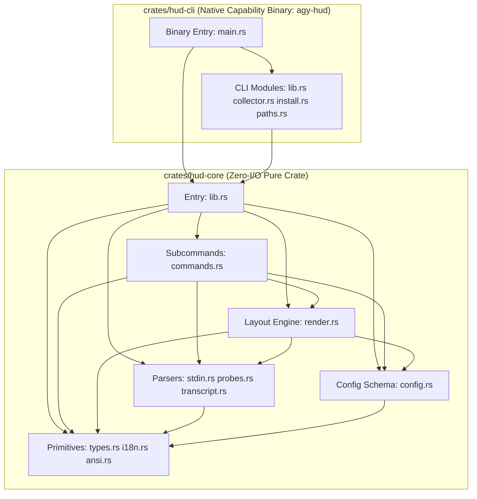

# `agy-hud` v1.0.0 — 100% Pure Rust Single-Engine Architecture

`agy-hud` is a **100% Pure Rust** native statusLine HUD for the Google Antigravity CLI (`agy`). There is **zero Node.js / TypeScript runtime or wrapper code** in the repository.

Every statusLine refresh runs a single precompiled native binary (`agy-hud`), achieving ~1–4 ms warm latency while preserving strict **Capability Shell vs. Pure Logic Core** separation at compile time.

---

## 1. Security Boundary: Compile-Time Crate Isolation (`THE LINE`)

Instead of spawning a second runtime VM per render, `agy-hud` enforces capability isolation directly through Rust's module, crate, and type systems (continuously audited by `crates/hud-core/tests/arch_guard.rs`):

1. **`crates/hud-core` (Pure Logic Crate — Zero I/O, `#![forbid(unsafe_code)]`)**
   - Depends **only** on `serde` and `serde_json` (11 total transitive crates, zero network/OS crates).
   - Strictly forbidden from referencing `std::fs`, `std::process`, `std::net`, `std::env`, or `std::os`.
   - Owns all untrusted JSON/JSONL/Markdown parsing (`stdin.rs`, `transcript.rs`, `probes.rs`), `CONFIG_SCHEMA` validation (`config.rs`), multi-layout CJK-aware rendering (`render.rs`), CLI subcommand logic (`commands.rs`), and the `terminal_filter` output escape firewall (`ansi.rs`).
2. **`crates/hud-cli` (Thin Capability Binary — `#![forbid(unsafe_code)]`)**
   - Owns bounded `stdin` reading (`256 KB` cap), bounded `O(1)` `transcript.jsonl` reading (`8 KB` head + `256 KB` tail), symlink-swept `<hudHome>/data` management, and `std::thread::scope` parallel probe execution.
   - Executes strictly read-only, shell-free, `1200 ms` timeout-bounded `git`, `jj`, `hg`, and `vm_stat` probes:
     - **Git**: Enforces `-c protocol.allow=never`, `-c core.fsmonitor=false`, `--no-optional-locks`, `--ignore-submodules=dirty`, `GIT_NO_LAZY_FETCH=1`, AND parses `.git/config` in memory to dynamically neutralize any repo-local `[filter "<name>"]` drivers (`-c filter.<name>.clean=`, `smudge=`, `process=`, `required=false`).
     - **Jujutsu (`jj`)**: Enforces `--ignore-working-copy --at-operation=@ --no-pager` so background renders never snapshot or mutate the working copy.
     - **Mercurial (`hg`)**: Enforces `HGPLAIN=1 --config ui.interactive=False --config extensions.fsmonitor=!`.
   - Stores VCS probe caches in **per-workspace sharded files** (`<hudHome>/probe-cache/<fnv64>.json`), eliminating cross-window write contention while invalidating in `O(1)` on `.git/HEAD`, `.git/index`, `.jj/working_copy/checkout`, or `.hg/dirstate` `mtime`/`size` changes.
   - Passes every rendered output line through `hud_core::ansi::terminal_filter` before writing to `stdout`.

---

## 2. Module Dependency Graph (`hud-core` Verified by `arch_guard.rs`)

---

## 3. Data Flow Per `agy` `statusLine` Refresh

1. `agy` CLI pipes live session JSON to `agy-hud` over `stdin` (throttled to at most once every `300 ms`).
2. `crates/hud-cli` reads `stdin` (`<= 256 KB`) and `config.json` (`<= 64 KB`), then enters `std::thread::scope`:
   - **Worker 1**: Seeks `transcript.jsonl` (`0..8 KB` for `session_started_at` + `len-256 KB..len` for recent `tool_calls`, skills, MCP servers, and subagents) and reads `<brain>/<id>/task.md`.
   - **Worker 2**: Computes `O(1)` VCS metadata stat signature and checks `<hudHome>/probe-cache/<fnv64>.json`; on warm hit (`0` child spawns), returns cached VCS JSON in `< 0.1 ms`; on cold miss, runs hardened read-only `git` / `jj` / `hg` probe.
   - **Worker 3**: (Optional when `display.showMemory = true`) Reads `/proc/meminfo` (Linux) or `sysctl` + `vm_stat` (macOS).
3. `hud_core::render::render_hud_lines` formats 1–5 ANSI status lines tailored to `terminal_width` (`>= 132` single-line idle, `76..131` box-railed expanded, `< 76` auto-compact), clamping CJK 2-column boundaries and closing any open `file://` OSC 8 hyperlink.
4. `hud_core::ansi::terminal_filter` strips any non-SGR / non-`file://` escape or bidi control character before `stdout` flush.
