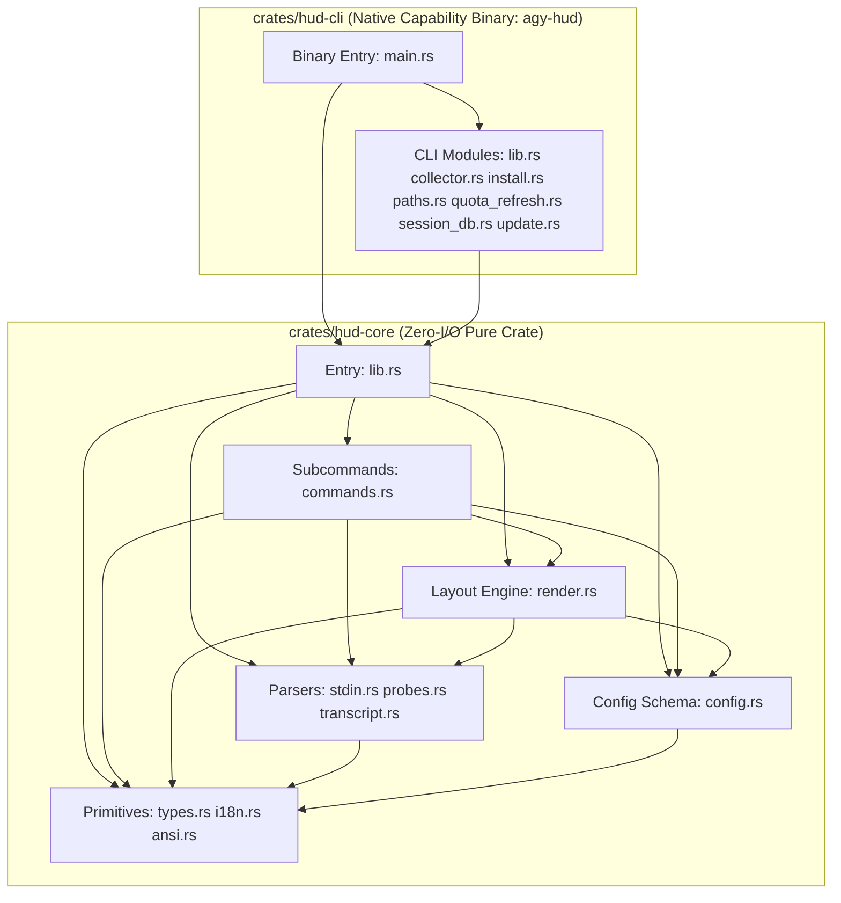

# `agy-hud` v1.10.0 — 100% Pure Rust Single-Engine Architecture

`agy-hud` is a **100% Pure Rust** native statusLine HUD for the Google Antigravity CLI (`agy`). There is **zero Node.js / TypeScript runtime or wrapper code** in the repository.

Every statusLine refresh runs a single precompiled native binary (`agy-hud`), achieving ~1–3 ms warm latency (and `< 1 ms` in `agy-hud title` terminal-title mode) while preserving strict **Capability Shell vs. Pure Logic Core** separation at compile time.

---

## 1. Security Boundary: Compile-Time Crate Isolation (`THE LINE`)

Instead of spawning a second runtime VM per render, `agy-hud` enforces capability isolation directly through Rust's module, crate, and type systems (continuously audited by `crates/hud-core/tests/arch_guard.rs`):

1. **`crates/hud-core` (Pure Logic Crate — Zero I/O, `#![forbid(unsafe_code)]`)**
   - Depends **only** on `serde` and `serde_json` (11 total transitive crates, zero network/OS crates).
   - Strictly forbidden from referencing `std::fs`, `std::process`, `std::net`, `std::env`, or `std::os`.
   - Owns all untrusted JSON/JSONL/Markdown parsing (`stdin.rs`, `transcript.rs`, `probes.rs`), `CONFIG_SCHEMA` validation (`config.rs`), extended grapheme cluster width/truncation & capability-scoped `terminal_filter_with_repo` output escape firewall (`ansi.rs`), composable multi-layout CJK-aware rendering (`render.rs`, including `render_title_line` plain single-line terminal titles <= 80 cols), `auto_edit` -> `[ACCEPT]` / `[BATTLE]` mode badges, heterogeneous subagent model badges (`format_subagent_model_label` / `display.showSubagentModel`), optional 8-char session ID prefix (`display.showSessionId`), `sandbox.allow_network` `(net)` indicator, `cost.subagent_usd` breakdown, `exceeds_200k_tokens` `(>200k)` cold-start hint, DB-first auto-compaction ceiling resolution (`DbGenMetadata` > `SessionCheckpoint` > `PhysWindowSmall` > `LearnedModelCache` > `Unknown`, rendering neutral `<used>/?` on unconfirmed `>= 900k` cold starts instead of guessing `256k`), dual-threshold implicit `↻N` compaction detection (`> 5k` and `>= 25%` prompt-token drop, excluding shadow/utility models with Undo/rewind `step_index` immunity), quota `0%` Proto3-omitted exhaustion inference + `<= 2000-01-01` sentinel reset filtering & pace projection, hybrid `~tok/s` speed-tier & session `(min~max)` throughput tracking, cross-session cost ledger reconciliation, width-preserving privacy scrubbing (`commands.rs`, `doctor` `title` inspection, and `preview --title`), and the declarative corpus snapshot suite (`tests/corpus/*.json` + `tests/corpus_cases.rs`).
2. **`crates/hud-cli` (Thin Capability Binary — `#![forbid(unsafe_code)]`)**
   - Owns non-blocking early-exit `stdin` JSON reading (`1000 ms` open-pipe guard, `256 KB` cap, `AGY_HUD_NESTED=1` / `AGY_HUD_DISABLE` fast inert exit), ultra-fast `agy-hud title` mode (reads only `stdin` + optional `config.json`, renders `render_title_line`, and skips `data_dir`, SQLite, VCS/memory subprocesses, heartbeat/snapshot writes, and background spawns), `O(1)` hot-path `prepare_data_dir_fast` paired with post-flush hourly `maybe_maintain_data_dir` (`> 14d` age / `> 256` entry bounded eviction across `transcript-cursors/`, `db-ceilings/`, `compaction-ceilings/`, `speed-cache/`, and `probe-cache/`), incremental `O(Δ)` `transcript.jsonl` byte-cursor reading (`<hudHome>/data/transcript-cursors/<fnv64>.json`, v3 cursor tracking Undo/rewind bounds and deleting stale cursors on shrink/truncation), pure-Rust strictly read-only SQLite B-tree + committed `-wal` reader (`session_db.rs`, zero C/SQLite dependencies, zero `-shm` creation or locks) extracting Turn-1 `gen_metadata` (`1 -> 9 -> 10 -> 4`, skipping shadow/non-matching subagent rows) and `executor_metadata` (`10 -> 2 -> 5`) ceilings from `conversations/<id>.db` with stat-keyed caching (`<hudHome>/data/db-ceilings/<fnv64>.json`), per-session sharded throughput snapshot persistence (`<hudHome>/data/speed-cache/<fnv64>.json`, falling back to `data/speed-cache.json` only when session/conversation IDs are absent), exclusive-lockfile per-model compaction ceiling persistence (`<hudHome>/data/compaction-ceilings/<fnv64>.json` with exponential backoff), no-op-skipping exclusive-lockfile cross-session cost ledger persistence (`<hudHome>/data/cost-ledger.json` + `cost-ledger.lock`, acquiring locks only when spend changes), lazy `detect_unprefixed_skills` (evaluated only when config warnings or update badges require command selection), `HeartbeatInfo.outcome` `"degraded:write"` reporting on non-fatal persistence errors, lossless `install --with-title`/`--no-title`/`--replace` (`previous-title.json`) + `uninstall` restoration, and opt-in isolated `/usage` quota refresh (`quota_refresh.rs`).
   - Resolves probe executables (`git`, `jj`, `hg`, `sysctl`, `vm_stat`, `agy`, `curl`, `tar`, `powershell`) strictly from **absolute** directories in `PATH` (`resolve_executable_in_path`), defeating Windows `CreateProcessW` working-directory hijacking (`git.exe` / `git.bat` / `git.cmd` planted in an untrusted repo `cwd`) and relative `PATH` injection.
   - Executes strictly read-only, shell-free, `1200 ms` timeout-bounded `git`, `jj`, `hg`, and `vm_stat` probes:
     - **Git**: Enforces `-c protocol.allow=never`, `-c core.fsmonitor=false`, `--no-optional-locks`, `--ignore-submodules=dirty`, `GIT_NO_LAZY_FETCH=1`. Parses `.git/config` in memory (0 extra subprocesses when no `[include]` / `[includeIf]` exists); when `[include]` is present, runs `git config --show-scope -z --get-regexp ^(core\.repositoryformatversion|filter\.)` to neutralize `local`/`worktree`/`command` filters while preserving `global`/`system` filters (such as `git-lfs`). If any filter name violates `^[\w.-]+$` or `git` times out, aborts before `git status` and falls back to zero-subprocess `.git/HEAD` parsing (`read_git_head_fallback`). Also extracts & normalizes `[remote "origin"] url` strictly to `https://github.com/<owner>/<repo>` (stripping any non-GitHub or credentialed URLs).
     - **Jujutsu (`jj`)**: Enforces `--ignore-working-copy --at-operation=@ --no-pager` so background renders never snapshot or mutate the working copy.
     - **Mercurial (`hg`)**: Enforces `HGPLAIN=1 --config ui.interactive=False --config extensions.fsmonitor=!`.
     - **Host Memory (`probe_memory_cached`)**: On Linux reads `/proc/meminfo` directly; on macOS caches `sysctl -n hw.memsize` (`total_bytes`) and `vm_stat` readings in `<hudHome>/probe-cache/memory.json` with a `2000 ms` TTL (`0` subprocesses on cache hits).
   - Stores VCS probe caches in **per-workspace sharded files** (`<hudHome>/probe-cache/<fnv64>.json`), eliminating cross-window write contention while invalidating in `O(1)` on `.git/HEAD`, `.git/index`, `.jj/working_copy/checkout`, or `.hg/dirstate` `mtime`/`size` changes, and bypasses subprocesses entirely via the **lightweight VCS fast path** when `stdin.vcs` already provides `branch`/`client` and `!vcs.showAheadBehind && !vcs.showFileStats && !hyperlinks` (or CitC `client` is active).
   - Supports optional official `/usage` quota cache reconciliation (`quota.backgroundRefresh = false` by default, or manual `agy-hud quota refresh`) executed in an empty isolated temp directory with `AGY_HUD_NESTED=1`, `AGY_CLI_DISABLE_AUTO_UPDATE=true`, `GEMINI_API_KEY` short-circuiting (hiding quota probes when API-key mode is active), exclusive lockfile ownership, `hud_home.exists()` pre-write uninstall race guard, exit code `2` (`UnsupportedAuthExit2` -> `24h` cooldown backoff), exit code `3` (`TimeoutExit3`), and `60 s..600 s` exponential transient failure backoff.
   - Passes every rendered output line through `hud_core::ansi::terminal_filter_with_repo` before writing to `stdout`.
3. **CI/CD & Marketplace Supply-Chain Guard (`crates/hud-core/tests/arch_guard.rs`)**
   - Audits `.github/workflows/*.yml` for explicit least-privilege `permissions:` and enforces Node.js 24-native (or composite) GitHub Action major versions (`actions/checkout@v7+`, `actions/upload-artifact@v7+`, `actions/download-artifact@v8+`, `softprops/action-gh-release@v3+`, `Swatinem/rust-cache@v2+`, `dtolnay/rust-toolchain@stable`), preventing deprecated Node.js 20 runner warnings.
   - Audits bundled Marketplace binaries (`scripts/bin/<platform>/agy-hud`) for `0755` executable permissions and exact embedded `agy-hud <version> (rust-native)` version parity with `Cargo.toml` and `plugin.json`.

---

## 2. Module Dependency Graph (`hud-core` Verified by `arch_guard.rs`)

---

## 3. Data Flow Per `agy` `statusLine` / `title` Refresh

1. `agy` CLI pipes live session JSON to `agy-hud` (or `agy-hud title` when terminal tab titles are enabled) over `stdin` (throttled to at most once every `300 ms`).
   - **`agy-hud title` Fast Path**: Reads bounded `stdin` and optional `config.json`, resolves `Language::Auto`, renders plain single-line text via `hud_core::render::render_title_line`, filters via `terminal_filter`, and exits `0` with zero `data_dir`, SQLite, VCS/memory subprocesses, heartbeat/snapshot writes, or background spawns.
2. `crates/hud-cli` (`statusLine` mode) runs `prepare_data_dir_fast` (`O(1)` symlink check without recursive scanning), reads `stdin` (`<= 256 KB`) and `config.json` (`<= 64 KB`), and enters `std::thread::scope`:
   - **Worker 1**: Uses `<hudHome>/data/transcript-cursors/<fnv64>.json` to seek directly to the incremental `O(Δ)` byte offset in `transcript.jsonl` (falling back to `0..32 KB` head + `len-512 KB..len` tail on cold >2 MB files) and reads `<brain>/<id>/task.md`.
   - **Worker 2**: If `stdin.vcs` already carries `branch`/`client` and `!vcs.showAheadBehind && !vcs.showFileStats && !hyperlinks` (or CitC `client` is present), skips subprocesses completely (`0` child spawns); otherwise computes an `O(1)` VCS metadata stat signature and checks `<hudHome>/probe-cache/<fnv64>.json` before falling back to hardened read-only `git` / `jj` / `hg` probes via `resolve_executable_in_path`.
   - **Worker 3**: (Optional when `display.showMemory = true`) Reads `/proc/meminfo` (Linux) or `probe_memory_cached` (`sysctl` + `2000 ms`-cached `vm_stat` in `<hudHome>/probe-cache/memory.json` on macOS).
   - **Worker 4**: Checks `<hudHome>/data/db-ceilings/<fnv64>.json` against `conversations/<id>.db` + `-wal` `mtime`/size + active model hint; on miss, reads SQLite B-tree pages and committed WAL frames read-only in `session_db.rs` to extract Turn-1 `DbCeilingInfo`.
3. `hud_core::probes::reconcile_cost_ledger` performs an in-memory pre-check against `<hudHome>/data/cost-ledger.json` for `Today` / `Week` cost totals without double counting across `300 ms` ticks, acquiring `cost-ledger.lock` only when session spend actually changes (while ignoring `<= 2000-01-01` sentinel reset timestamps).
4. Per-session throughput snapshots persist to `<hudHome>/data/speed-cache/<fnv64>.json` (isolating concurrent terminal windows and Swarm workers), `detect_unprefixed_skills` runs lazily only when config problems or update badges exist, and any non-fatal persistence failure sets `HeartbeatInfo.outcome = "degraded:write"` (surfacing in `agy-hud doctor`) while keeping exit code `0`.
5. `hud_core::render::render_hud_lines_full` resolves active quota buckets (inferring `0%` remaining on active non-disabled Proto3-omitted buckets and dropping sentinel/expired windows before canonical/Argon routing), computes context metrics (`<used>/?` neutral cold-start display with optional `(>200k)` hint when `exceeds_200k_tokens` is true and `EffectiveCeiling::Unknown`), formats ANSI status lines tailored to `terminal_width` (`>= 180` single-line idle, `76..179` box-railed expanded with optional `display.mergeGroups` & `display.rightAlign`, `< 76` auto-compact), clamps extended grapheme cluster boundaries, closes open OSC 8 hyperlinks, and appends an explicit `⚠ Config: ... · /agy-hud:hud` line if `config.json` had validation warnings.
6. `hud_core::ansi::terminal_filter_with_repo` strips any non-SGR / non-`file://` / non-scoped-GitHub-branch escape or bidi control character before `stdout` flush; afterwards, `maybe_maintain_data_dir` runs at most once per hour (`data/.maintenance-at`) to sweep symlinks and evict cache entries older than `14d` or exceeding `256` files per directory.
